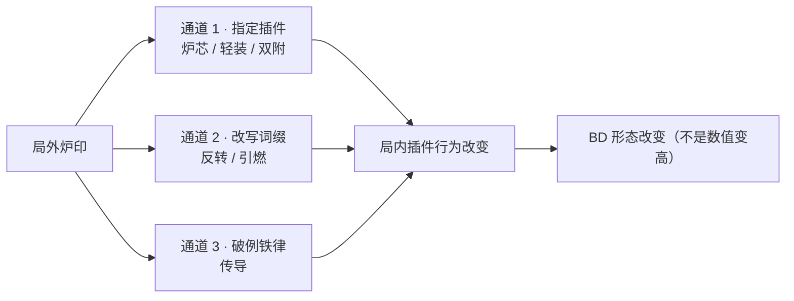

# 熔炉核心 · 过载 — 核心机制 / 数值 / 五档局外升级（方案 v0.1）

> **定位**：单核心完整方案，供原型实现与数值验证。属设计稿，未回写真值表。
> **依据**：HTML 4.6（热量值）、4.7（超限）、4.8（核心）、05 数值初稿；行为表 v0.8（B/C/D 页热能值）。
> **前置结论**（已确认）：核心为**局外固定装配**。
> 日期：2026-10-27

---

## 一、一句话定位

**熔炉把「热量条」从消耗型资源，改造成「伤害蓄能条」——超限释放不再烧热，改为烧血；热量存得越满，这一发越狠。**

它服务两个爽感轴：**核爆（主）+ 赌命（副）**。
玩家每一秒都在做一个选择：**现在就打（×1.0），还是再等等（最高 ×2.0）**。

---

## 二、核心机制（四条规则改写）

### R1 释放条件改写：门槛降低，取消固定阈值

| 项 | 默认核心 | 熔炉核心 |
|---|---|---|
| 释放条件 | 热量 ≥ 插件阈值（65 / 70 / 75 / 80） | **热量 ≥ 40**（阈值作废） |
| 热量扣除 | 扣除阈值点数 | **释放后热量归零**（全部兑现） |

设计意图：把「够不够」的门槛问题，换成「值不值」的选择问题。40 点就能打，但打出去只有 ×1.0，玩家自己决定要不要等。

### R2 成本改写：热量不再付费，改付生命

- 超限释放消耗 **15% 最大生命**（不是当前生命，避免低血时变成免费）。
- 释放后至少保留 1 点生命；**生命 ≤ 15% 最大生命时无法释放**（炉心不稳）。
- **击杀返还**：本次超限每击杀 1 个敌人，返还 **50% 消耗**（7.5% 最大生命），最多返还 100%（2 杀封顶）。

> 这条是可持续性的关键：对群怪可以自循环，对单体 Boss 是净亏血——**天然区分了「清场」与「攻坚」两种用法**。

### R3 热量规则改写：不衰减，但怕被打

| 项 | 默认核心（建议值） | 熔炉核心 |
|---|---|---|
| 自然衰减 | 5 点/秒 | **不衰减** |
| 受击 | 不额外损失 | **损失当前热量的 10%** |
| 脱战 | 保留 | **脱战 4 秒后清空** |

> 「不衰减」是存热玩法的地基；「受击流失」和「脱战清空」是防止它变成无限存钱罐的两道闸。

### R4 伤害改写：热量线性转伤

```
超限伤害倍率 = 1 + (当前热量 − 40) / 80 × 1.0     （上限 ×2.0）
```

| 当前热量 | 40 | 60 | 80 | 100 | 120 |
|---|---|---|---|---|---|
| 倍率 | ×1.00 | ×1.25 | ×1.50 | ×1.75 | ×2.00 |

记忆点：**每 8 点热量 = +10% 伤害**。

### 2.5 与既有真值的冲突检查

| 真值条目 | 是否冲突 | 说明 |
|---|---|---|
| HTML 4.6「热量超限转伤害仅特定核心启用」 | ✅ 一致 | 熔炉就是那个「特定核心」 |
| HTML 4.7「超限消耗热量」 | ⚠️ 覆盖 | 仅在熔炉下改为耗血，默认核心不变 |
| D 页「释放条件：热量 ≥ 65/70/75/80」 | ⚠️ 覆盖 | 熔炉下统一为 ≥40，属核心特权 |
| 「中继触发的技能不产热」 | ✅ 遵守 | 熔炉默认不改；仅在 T4 炉印「传导」下破例 |
| 超限零载荷、不编程 | ✅ 遵守 | 不变 |

---

## 三、数值

### 3.1 热量收支（现有表实测值）

| 来源 | 热量 | 节奏 |
|---|---|---|
| 攻击序列根 · 三段连击（炽燃斩 / 破韧重装 / 雷矢链刺） | 2+3+4 = **9** | 一套约 2.2s |
| 攻击序列根 · 多重连刺（5 段） | 2×5 = **10** | 一套约 2.0s |
| 攻击序列根 · 蓄力重斩 | 点按 2 / 满蓄 **8** | 满蓄 1.5s |
| 重装序列根 · 任意插件 | **22** | CD 6s（浮游炮 8s） |
| 中继触发的子技能 | **0** | 铁律，T4 才可破例 |
| 上限 | **120** | — |

### 3.2 存满时间预算

| 打法 | 热量/秒 | 存满 120 | 打到 40（最低释放） |
|---|---|---|---|
| 纯攻击连段 | ≈4.1 | **≈29s** | ≈10s |
| 攻击 + 重装交替 | ≈5.5 | **≈22s** | ≈7s |
| 仅重装（等 CD） | ≈3.7 | ≈33s | ≈11s |

> **设计红线**：单场战斗时长若短于 20s，熔炉几乎无法完成一次完整存热 → 要么拉长战斗，要么靠 T1 炉印「预热 / 余烬」补积热。这条要在原型第一轮就验证。

### 3.3 超限伤害校验（以 III 档为例）

| 超限插件 | 基础总伤 | ×1.0（40 热） | ×1.5（80 热） | ×2.0（120 热） |
|---|---|---|---|---|
| 蓄力重斩 III | 42+63+84 = **189** | 189 | 284 | **378** |
| 炽燃斩 III | 42+56+70 = **168** | 168 | 252 | 336 |
| 破韧重装 III | 28+35+42+49 = **154** | 154 | 231 | 308 |
| 多重连刺 III | 7×10 = **70** | 70 | 105 | 140 |

> 多重连刺超限总伤低，但 10 段高频、削韧高、可边打边位移——它是「安全牌」，不是「核弹牌」。这个差异要保留。

### 3.4 生命成本与可持续性

| 场景 | 每发成本 | 净成本 | 满血可连发 |
|---|---|---|---|
| 对单体 Boss（0 杀） | 15% | 15% | **6 发** |
| 对群怪（每发 1 杀） | 15% | 7.5% | **13 发** |
| 对群怪（每发 ≥2 杀） | 15% | 0% | 无限（受热量限制） |

> 结论：熔炉在清场战里是永动机，在 Boss 战里是消耗品。这个不对称就是它的性格。

### 3.5 与默认核心的定位差

| 维度 | 默认核心 | 熔炉核心 |
|---|---|---|
| 释放门槛 | 65–80 热 | 40 热 |
| 热量处理 | 扣阈值，余量保留 | 全部清空兑现 |
| 伤害倍率 | ×1.0 | ×1.0–2.0 |
| 额外成本 | 无 | 15% 最大生命 |
| 节奏 | 打满就放 | 现在打还是再等 |
| 单发上限 | 基准 | **+100%** |
| 持续输出 | 稳定 | 略降（存热期不放大） |

**目标区间**：单发峰值 +80~100%，整体 DPS 与默认核心差 ±10% 以内。熔炉不该是「更强」，而是「更极端」。

### 3.6 反馈设计（不做就无法感知）

- **炉压表**：热量条上标出 40 / 80 / 120 三个刻度，实时显示「当前倍率 ×1.75」。
- **超限按钮**：显示「消耗 15% 生命 · ×1.75」，低血时变红并禁用。
- **受击**：热量条被打掉一段时闪一下，让玩家知道「存的钱被抢了」。
- **满热**：机体冒白汽 + 轻微屏震，提示「可以打了，但还能更狠」。

---

## 四、局外升级：炉印系统（5 档）

### 4.1 结构

- **载体**：炉印（Forge Sigil）。刻在机甲核心上，不是刻在插件上。
- **槽数 = 档位**：T1 有 1 槽，T5 有 5 槽。
- **每档 3 枚选 1**：同一档内互斥，防止同类叠加滚雪球。
- **不可重复**：同一枚炉印只能镶一次。
- 5 档 × 3 枚 = 15 枚，满级时可组出 3^5 = **243 种组合**。

### 4.2 五档详解

#### T1 · 炉膛（热量经济）

| 炉印 | 效果 | 关联局内对象 | 开启的玩法 |
|---|---|---|---|
| **预热** | 每场战斗开始热量 = 30 | 全局热量 | 开局 10s 内就能打第一发 |
| **余烬** | 超限释放后 4s 内，根命中积热 ×1.5 | 攻击序列根插件 | 兑现后快速回炉，缩短第二发周期 |
| **稳焰** | 受击热量流失 10% → 5% | 全局热量 | 抗压存热，适合贴脸打法 |

> 解锁条件：首次装备熔炉核心。

#### T2 · 燃料（指定炉芯插件）

| 炉印 | 效果 | 关联局内对象 | 开启的玩法 |
|---|---|---|---|
| **炉芯** | 指定 1 个行为插件，其**根命中积热 ×2** | 任意行为插件（局外选、局内可换） | 把「多重连刺」变成引擎：存满 120 从 29s 压到 **12–15s** |
| **轻装** | 炉芯插件载荷 **−20%** | 该插件载荷 | 省下的载荷换第二个子技能 |
| **双附** | 炉芯插件可**额外附着 1 个赋能**（2 → 3，仅熔炉） | 赋能上限规则 | 一颗插件吃三个词缀，做「单点极限」 |

> 解锁条件：累计释放超限 30 次。
> 设计要点：**炉芯是「局外决定谁是引擎」**——这是局外与局内最深的一处咬合。

#### T3 · 热交换（攻防转换）

| 炉印 | 效果 | 关联局内对象 | 开启的玩法 |
|---|---|---|---|
| **热盾** | 热量 ≥100 时，受到伤害 −15% | 全局 | 存热期从「裸奔」变成「带甲」，敢贴脸存 |
| **溢流** | 超出 120 的热量转为护盾（上限 30，脱战清空） | 全局 | 高积热 Build 有了溢出出口，不再浪费 |
| **回火** | 超限释放后 3s 内受击不流失热量 | 全局 | 兑现后立刻重新存，不被打了断 |

> 解锁条件：单场热量达到 120，累计 3 次。

#### T4 · 合金（跨插件传导）

| 炉印 | 效果 | 关联局内对象 | 开启的玩法 |
|---|---|---|---|
| **传导** | **中继触发的子技能也积热**（按 50% 效率） | 中继 + 子行为插件 | **破例铁律**：分支流也能存热 → 织网式熔炉混合流成立 |
| **引燃** | 超限释放命中即施加燃烧（满条） | 超限插件 + 燃烧状态 | 超限变成状态源 → 与灼芯回路 / 助燃联动 |
| **反转** | 「热量节流」词缀效果反转（−X% 积热 → +X% 积热） | 赋能词缀 EN_THROTTLE | 把公认的负收益词缀翻成正收益，最便宜的一课 |

> 解锁条件：用熔炉核心通关 5 场。
> **这一档是全系统的关键**：它第一次允许熔炉改写「中继不产热」这条铁律，且代价是 50% 效率——破例但不失控。

#### T5 · 临界（终局）

| 炉印 | 效果 | 关联局内对象 | 开启的玩法 |
|---|---|---|---|
| **熔毁** | 每场 1 次主动技：生命降为 1、热量拉满、3s 无敌，期间超限免耗血 | 全局 | 反杀牌：残血时主动赌命 |
| **余温** | 超限击杀返还 **100%** 生命消耗 | 超限 + 击杀 | 清场流彻底自循环，Boss 战仍然亏 |
| **超压** | 热量上限 120 → **160**，倍率上限 ×2.0 → **×2.5** | 全局 | 更长的存热周期、更高的天花板 |

> 解锁条件：单场超限击杀 ≥10。

### 4.3 炉渣经济

| 项 | 数值 |
|---|---|
| 单场收入 | 基础 60 + 精英 15×n + Boss 40 ≈ **100–140** |
| T1 解锁 | 150 |
| T2 | 500 |
| T3 | 1,100 |
| T4 | 2,200 |
| T5 | 4,000 |
| **全解锁合计** | **7,950** ≈ 55–75 场 |

> 目标：**40–60 场内走完五档**。若实测偏慢，优先降 T4/T5，不要降 T1——第一档必须是「一场就能摸到」的。

### 4.4 防滚雪球

| 规则 | 作用 |
|---|---|
| 同档 3 选 1 | 阻止「三个积热类炉印叠一起」 |
| 每档只能镶 1 枚 | 槽数 = 档位，结构上锁死 |
| 同类数值上限 | 积热加成总和 ≤ +100%（炉芯 ×2 + 余烬 ×1.5 = 3.0，已触顶） |
| 炉印不提供纯伤害加成 | 所有炉印只改规则/资源/结构，不给「+X% 伤害」 |

---

## 五、局外 ↔ 局内 的关联设计

### 5.1 三条关联通道



| 通道 | 机制 | 例子 | 为什么不是数值 |
|---|---|---|---|
| 指定插件 | 炉印绑定某个插件 | 炉芯 ×2 积热 | 改变「谁是引擎」，其余插件价值重排 |
| 改写词缀 | 让某条词缀反义 | 反转 × 热量节流 | 同一个词缀价值反转 |
| 破例铁律 | 有代价地打破系统规则 | 传导（中继产热 50%） | 打开新的树形结构，不是加法 |

### 5.2 炉印 × 插件 关联矩阵

| 炉印 | 强关联插件 | 强关联词缀 | 强关联中继 | 产生的 BD 形态 |
|---|---|---|---|---|
| 炉芯 | 多重连刺 / 浮游机炮 | — | — | 快速存热爆发流 |
| 双附 | 炽燃斩 / 蓄力重斩 | 助燃 + 状态凝滞 + 精准校准 | — | 单点极限流 |
| 传导 | 失衡爆破下的所有子插件 | — | 灼芯回路 / 失衡爆破 | 分支存热混合流 |
| 引燃 | 蓄力重斩（超限） | 助燃 / 状态催化 | 灼芯回路 | 超限即点火流 |
| 反转 | 任意高频插件 | 热量节流 | — | 反向教学流 |
| 溢流 | 高频积热插件 | — | — | 存热坦克流 |
| 熔毁 | 任意 | — | — | 残血反杀流 |

### 5.3 三套「局外 → 局内」演化示例

**T1（只有预热）**
攻击树：多重连刺 II + 精准校准 → 重装树：破韧重装 II → 超限：蓄力重斩 III
循环：开局 30 热 → 打 20s 存到 120 → 一发 ×2.0。核心体验已成立，但节奏慢。

**T3（炉芯 + 热盾）**
炉芯给多重连刺（积热 ×2，10 → 20/套）→ 存满 120 从 29s 压到 **12–15s**；热盾让存热期敢贴脸。
变化：从「打带跑」变成「贴脸存钱」。**同一套插件，玩法反过来了**。

**T5（传导 + 余温）**
传导让中继子技能产热 → 攻击树只放一个失衡源，重装树用失衡爆破 III 拉 4 个分支，每个子技能命中都在存热 → **存满 120 只要 8–10s**。
变化：从「单根积热」变成「分支积热」，BD 结构完全不同。

---

## 六、风险与反爽点

| 风险 | 说明 | 处置 |
|---|---|---|
| 存热期过长 | 单场 <20s 时熔炉无法成型 | T1 预热/余烬补积热；或缩短战斗节奏 |
| 生命成本无出口 | 单体 Boss 战连发 6 次即残 | 击杀返还 + 热盾/溢流；Boss 战需自带回复手段 |
| 脱战清空太狠 | 玩家刚存满就脱战会挫败 | 4s 缓冲 + 明确 UI 倒计时 |
| 与多重连刺过强 | 积热 ×2 + 5 段高频 → 存满过快 | 炉芯积热加成设上限；实测若 <10s 需削到 ×1.6 |
| 熔毁过强 | 免费一发 + 3s 无敌 | 每场 1 次 + 生命降为 1 的硬代价 |
| 倍率看不懂 | 玩家不知道「再等值不值」 | 按钮实时显示倍率与血量消耗 |

---

## 七、原型验证清单（按顺序）

1. **存满时间**：无炉印情况下，混合打法存满 120 是否落在 20–25s。
2. **单发占比**：一发 ×2.0 超限占总血量的比例，目标 20–30%。
3. **连发上限**：满血对单体可连发几发（目标 5–6），对群怪是否自循环。
4. **对比默认核心**：同插件同载荷下，DPS 差是否在 ±10%，峰值是否 +80~100%。
5. **炉芯压力测试**：炉芯 + 多重连刺，存满是否被压到 15s 以下（若是则削系数）。
6. **感知测试**：不看数值，玩家能否说出「我现在是 ×1.5 还是 ×2.0」。

---

## 八、待拍板

| # | 决策项 | 本方案取值 | 备选 |
|---|---|---|---|
| 1 | 生命成本基准 | 15% 最大生命 | 12% / 18% |
| 2 | 击杀返还 | 50%/杀，100% 封顶 | 30% / 100% 不封顶 |
| 3 | 最低释放热量 | 40 | 50（更保守） |
| 4 | 倍率上限 | ×2.0 | ×1.8 / ×2.2 |
| 5 | 受击热量流失 | 10% | 8% / 15% |
| 6 | 脱战清空 | 4s | 6s / 不清空（改衰减） |
| 7 | 默认核心热量衰减 | 5 点/秒（**真值未定义，需确认**） | 3 / 8 |
| 8 | 炉印「每档 1 枚」 | 强制 | 允许跨档自由（组合更多但易滚雪球） |
| 9 | 熔毁是否保留 | 保留 | 删掉，换纯被动 |
| 10 | 炉渣总成本 | 7,950 | 5,000（更快解锁） |

---

*方案 v0.1 · 2026-10-27 · 待拍板后回写 HTML 4.8 与 05 数值初稿*
